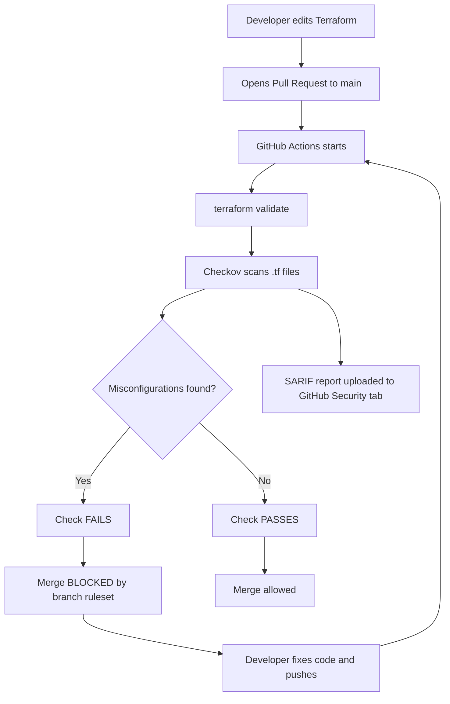
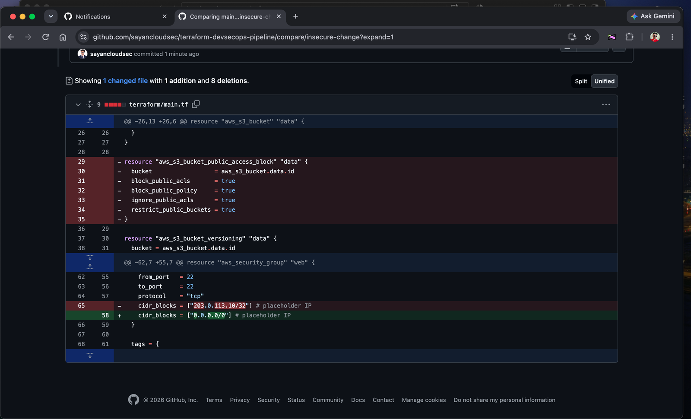
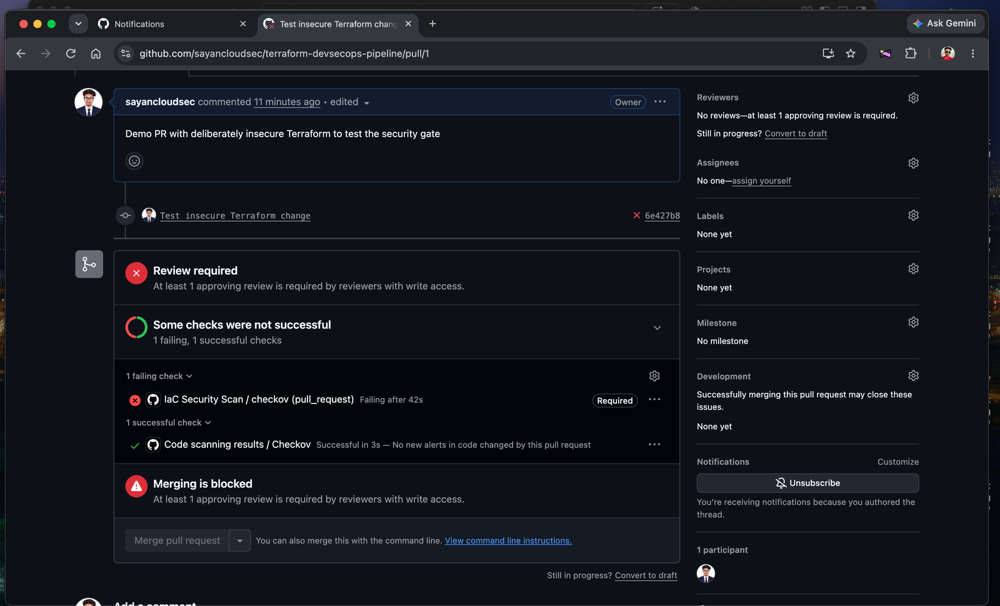
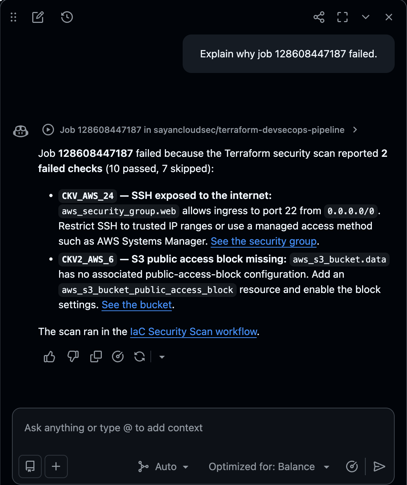
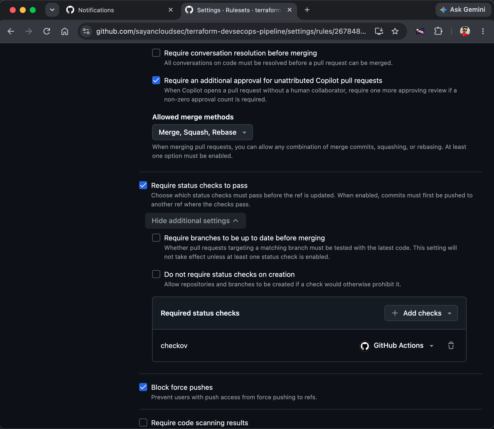
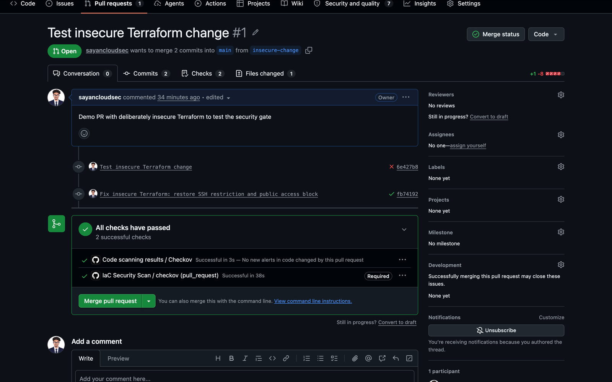

# Terraform DevSecOps Pipeline

A CI pipeline that scans Terraform code for cloud security misconfigurations **before** anything is deployed, and blocks insecure changes from being merged into `main`.


## Why this project

Fixing a misconfiguration in code takes minutes. Fixing it after it is deployed (and possibly exploited) takes far longer. This project applies **shift-left security**: the security check runs on every pull request, so an insecure change never reaches `main`.

No resources are ever created in AWS. The pipeline only reads the Terraform files, so it runs at zero cost.

## How it works



## Tech stack

| Tool | Purpose |
|---|---|
| Terraform (AWS provider) | Infrastructure as Code |
| Checkov | Static analysis of Terraform for security misconfigurations |
| GitHub Actions | CI workflow that runs on every pull request |
| GitHub Rulesets | Makes the `checkov` check required before merging to `main` |
| SARIF | Publishes findings to the GitHub Security tab |

## Repository structure

```
.
├── .github/
│   └── workflows/
│       └── security-scan.yml    # CI pipeline
├── terraform/
│   ├── main.tf                  # S3 bucket + security group
│   └── .terraform.lock.hcl      # Pinned provider version
├── docs/
│   └── screenshots/             # Images used in this README
├── .gitignore
└── README.md
```

## What the Terraform defines

- **S3 bucket** with public access blocked, versioning enabled, and server-side encryption (AES256)
- **Security group** allowing SSH only from a single trusted IP (`/32`), never from `0.0.0.0/0`
- **Tags** (`owner`, `environment`) on resources

## The pipeline

The workflow in [`.github/workflows/security-scan.yml`](.github/workflows/security-scan.yml) runs on every pull request to `main` and every push to `main`:

1. Checks out the code
2. Sets up Terraform and runs `terraform validate`
3. Runs Checkov against the `terraform/` directory
4. Uploads the results as SARIF to the GitHub Security tab

## Demo: blocking an insecure change

To prove the gate works, I opened a pull request with two deliberate mistakes:

1. The SSH rule was opened to the whole internet (`203.0.113.10/32` changed to `0.0.0.0/0`)
2. The S3 public access block resource was deleted



### Result: the scan fails

The required `checkov` check failed on the pull request and the merge button was disabled.



### Findings

Checkov reported **2 failed checks** (10 passed, 7 skipped) and pointed to exactly the two planted mistakes:



| Rule | Finding | Fix |
|---|---|---|
| `CKV_AWS_24` | Security group allows SSH (port 22) from `0.0.0.0/0` | Restrict `cidr_blocks` to a trusted `/32` address |
| `CKV2_AWS_6` | S3 bucket has no public access block | Add `aws_s3_bucket_public_access_block` with all four settings set to `true` |

### Branch protection

A repository ruleset on `main` requires a pull request and requires the `checkov` check from GitHub Actions to pass before merging. The bypass list is empty, so the rule applies to everyone, including the repo owner.



### Result: fix and merge

After restoring the restricted SSH rule and the public access block, the check passed and the pull request could be merged. The commit history on the PR shows the failing commit (red X) followed by the fix commit (green check).



## Checks skipped on purpose

This is a small demo, so a few Checkov rules that need extra infrastructure (replication, KMS keys, log buckets) are skipped with an inline comment explaining why. Every skip is documented in `terraform/main.tf`.

| Rule | Reason for skipping |
|---|---|
| `CKV_AWS_144` | Cross-region replication is not needed for the demo |
| `CKV_AWS_145` | SSE-S3 (AES256) is sufficient for the demo; KMS adds cost |
| `CKV_AWS_18` | Access logging needs a second log bucket; out of scope for the demo |
| `CKV2_AWS_62` | Event notifications are not required for the demo |
| `CKV2_AWS_61` | Lifecycle rules are not required for the demo |
| `CKV2_AWS_5` | The demo security group is not attached to an instance |
| `CKV_AWS_382` | No egress rules are defined in the demo |

In a production setup these would be fixed instead of skipped.

## Run it locally

You need Terraform and Checkov. On macOS:

```bash
brew install hashicorp/tap/terraform
brew install checkov
```

Then:

```bash
git clone https://github.com/sayancloudsec/terraform-devsecops-pipeline.git
cd terraform-devsecops-pipeline

# Validate the Terraform syntax
cd terraform
terraform init -backend=false
terraform validate
cd ..

# Run the security scan
checkov -d terraform/
```

None of these commands need AWS credentials, and `terraform apply` is never run.

## Key concepts demonstrated

- **Infrastructure as Code** security review with static analysis
- **Shift-left security**: catching issues at pull request time
- **CI/CD security gates** using GitHub Actions and required status checks
- **Policy enforcement** through branch rulesets with no bypass
- **Triage of findings**: fixing real issues and documenting justified skips
- **SARIF reporting** to the GitHub Security tab

## Possible improvements

- Add a custom Checkov policy (for example, require an `owner` tag on every S3 bucket)
- Add a second scanner (tfsec or Trivy) and compare findings
- Add a pre-commit hook so the scan also runs on the developer's laptop
- Deploy to a sandbox AWS account using GitHub OIDC instead of stored access keys

## Author

Sayan Mondal | [@sayancloudsec](https://github.com/sayancloudsec)
